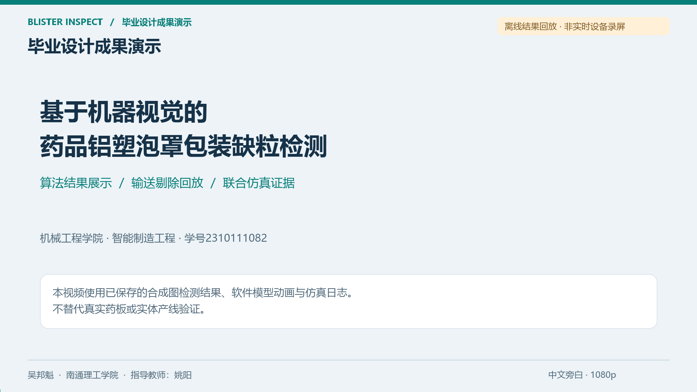
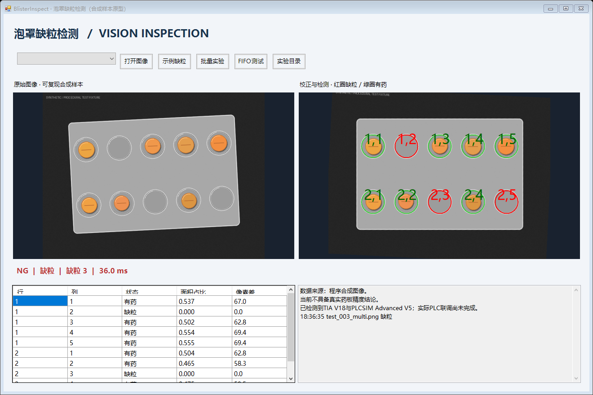

# BlisterInspect

## 泡罩药品缺粒检测与输送剔除仿真

毕业设计项目，作者吴邦魁，南通理工学院智能制造工程专业。

使用 C# WinForms 和 HALCON 检测泡罩药板中的缺粒位置，再由虚拟 S7-1500 PLC 跟踪工件、控制输送与剔除。Factory I/O 用来观察传感器触发、推杆动作和出口分流。

[观看演示视频（约 2 分 50 秒）](media/demo.mp4) · [查看验证数据](verification.json)

视频根据保存的检测结果制作动画，并结合 Factory I/O 场景截图讲解控制流程；属于结果回放与演示说明。

## 实现内容

- 视觉检测：支持 2×5、2×6 泡罩阵列，定位并校正药板，逐格判断缺粒，显示位置标注和检测结果。
- 控制交互：通过药板编号关联请求与结果，使用队列管理输送过程，处理检测超时、心跳异常和复位。
- 虚拟产线：在 TIA Portal V18 中编译控制程序并下载至 PLCSIM Advanced，联动 Factory I/O 传感器、输送带和推杆。
- 设计资料：完成机械与电气方案、论文、答辩稿和演示视频。

## 检测界面

上图为视觉原型阶段截图，展示缺粒标注和逐格结果；图中的联调状态文字为当时记录。后续虚拟产线验证结果见下表。

## 验证结果

| 检查项 | 结果 |
| --- | --- |
| 图像测试 | 400 张程序合成样本，其中 160 张用于留出测试 |
| PLC 工程 | 硬件与软件编译、下载完成 |
| 出口分流 | 有限批次累计核对 83 件：39 件正常、44 件剔除 |
| 超时处理 | 上述剔除件中含 1 件检测超时 |
| 场景保存 | 已核对原生场景保存与重新打开 |

测试对象为合成图像和虚拟设备，用于检查检测逻辑、通信与分流流程。83 件数据属于多轮有限批次验证。

## 技术栈

C# · .NET Framework 4.8 · WinForms · HALCON 20.11 · TIA Portal V18 · S7-PLCSIM Advanced V5 · Factory I/O 2.5

本仓库提供求职展示材料。完整工程包含视觉与 PLC 源码、原生场景、设计图纸和验证记录，可在项目交流时进一步展示。
